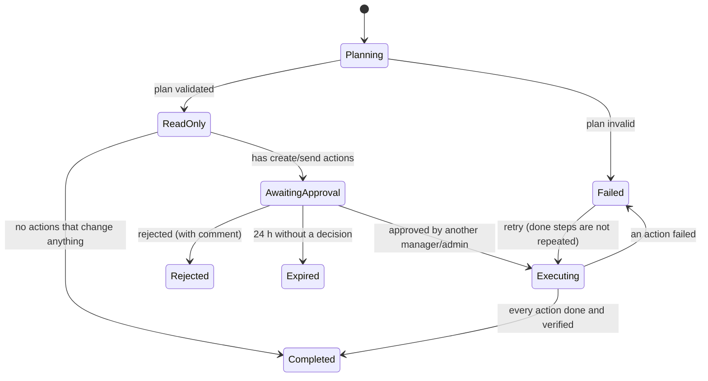

# Agents and human approval (Phase 5)

An agent turns a request like *"Customer jane@globex.com can't log in. Open a high priority ticket and email her."* into steps, runs the harmless ones, and waits for a person before doing anything that creates or sends something.

## The workflow

It is built as two **LangGraph** state graphs (`backend/app/modules/agents/graph.py`):

| Graph | Nodes | Runs when |
|---|---|---|
| Plan graph | `plan` → `run_read_only` → `request_approval` or `finish` | The request is submitted |
| Execute graph | `execute_approved` → `verify` → `finish` | A manager approves (or retries) |

**Why two graphs instead of one graph with an interrupt.** The pause for approval can last hours and must survive restarts, be tenant-scoped, and be audited like every other record. It's stored in PostgreSQL (`agent_runs`, `approval_requests`) instead of a LangGraph checkpointer. That also avoids a second PostgreSQL driver, since there's no LangGraph checkpointer for the async SQLAlchemy stack used everywhere else.

## Tools

The registry in `backend/app/modules/agents/tools.py` is the **complete** list of what an agent can do. There's no free-form SQL, no shell, and no arbitrary HTTP.

| Tool | Changes anything? | What it does |
|---|---|---|
| `search_documents` | No, runs immediately | Hybrid search (Phase 4) with the **requester's** permissions |
| `create_ticket` | Yes, needs approval | Creates a ticket (`TCK-1001`, … per organization); with a ServiceNow connection also a ServiceNow incident (Phase 6) |
| `lookup_customer` | No, runs immediately | Looks up the customer in Salesforce if connected (Phase 6) |
| `notify_customer` | Yes, needs approval | Sends the email through the email connection if configured (Phase 6), otherwise only records it in the outbox. `{{ticket_number}}` is replaced by the ticket created earlier in the same run (the ServiceNow number when connected). |

Every tool has a strict argument schema (Pydantic, unknown fields forbidden). Arguments are validated when the plan is made, and again right before execution.

## Planners

| Planner | `NEXUS_AGENT_PLANNER` | How | Limits |
|---|---|---|---|
| Rules (default) | `rules` | Keyword and pattern rules: ticket words, email addresses with "email/notify/let … know", questions → search | Understands a few phrasings only; titles and emails are template-based. Offline and free. |
| LLM | `openai` | An OpenAI-compatible model returns `{"steps": [...]}` in JSON mode | Behaviour tested against a mocked API only; plan quality with a real model is **not measured** yet |

**Planner output is untrusted.** `validate_plan` rejects the whole plan if any step uses an unknown tool, has invalid or extra arguments, or the plan exceeds `NEXUS_AGENT_MAX_STEPS` (5). Tests cover a model proposing `run_sql` with `DROP TABLE users`, and invalid email addresses.

## Approval rules

- Only **managers and org admins** can approve or reject, and only within their organization.
- **Separation of duties:** nobody can decide on their own request, whatever their role. A one-person organization therefore can't execute actions. This is deliberate; add a second manager in **Users**.
- The approver sees the **exact** actions and arguments. They are stored as a snapshot on the approval request, and only those steps run.
- Requests **expire** after `NEXUS_APPROVAL_TTL_HOURS` (24).
- The decision is one conditional `UPDATE … WHERE status = 'pending' AND expires_at > now()`. If two managers click "approve" at the same moment, exactly one wins and the other gets 409 (tested with concurrent requests).
- Every step is audited: `agent.run_started`, `agent.approval_requested`, `agent.approved` / `agent.rejected` (with the comment), `agent.action_executed` / `agent.action_failed`.

## Reliability

- **Decision first, then execution.** The approval is committed before any action runs, so a crash can't lose or repeat the decision.
- **One savepoint per action.** If an action fails halfway, its partial writes are rolled back. Later actions are marked `skipped`.
- **Idempotent actions.** Tickets and outbox messages are unique per `(agent_run_id, step_index)`, so running a step twice returns the record from the first time.
- **Retry.** A manager can retry a failed approved run. Completed steps aren't repeated, and `{{ticket_number}}` reuses the ticket from the first attempt (tested).
- **Verification.** After execution, every created record is re-read from the database before the run is marked completed.
- Ticket numbers are allocated under a row lock on the organization, so concurrent runs get unique, consecutive numbers.

## Known limitations

- Execution runs inside the approval request (actions are single database writes, so this is quick). Long-running tools would move to the background worker.
- Plans can't be edited before approval; reject the plan and submit a new request.
- The rule planner is deliberately simple. The LLM planner is the path to flexible requests, but its plan quality hasn't been evaluated with a real model.
