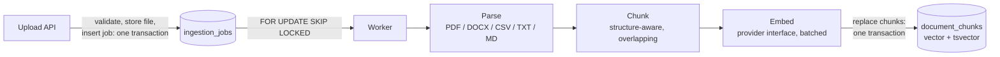

# AI design: document ingestion

This page covers how documents are turned into searchable knowledge (Phase 3). Retrieval and answer generation (Phase 4) build on it and will be added here.

## Pipeline

1. **Upload** (`POST /documents`). Validation runs before anything is stored: the extension must be allowed, the content must match it (PDF magic bytes, a DOCX must be a zip containing `word/document.xml`, text must decode and contain no NUL bytes), the size must be under `NEXUS_MAX_UPLOAD_MB`, and a DOCX may not expand beyond 100 MB (zip-bomb guard). A SHA-256 of the file detects duplicates within the organization. The file, the document row, its version row, the ingestion job and the audit event are committed together.
2. **Parse** (worker). Text is extracted per PDF page (so chunks can cite pages), from DOCX paragraphs and tables, and from CSV rows. Each CSV row becomes a line like `name: Acme; region: EU; revenue: 100`, so a chunk is understandable without the header row. A PDF with no extractable text fails with "it may be a scanned image; OCR is not supported yet".
3. **Chunk.** Text is split on structure first (blank lines, Markdown headings), then sentences, and only hard-split as a last resort. Pieces are packed into chunks of up to `NEXUS_CHUNK_SIZE` characters (default 1,200, about 300 tokens), and each chunk starts with up to `NEXUS_CHUNK_OVERLAP` characters (default 200) from the end of the previous chunk, so a fact on a boundary is still found in one chunk. Each chunk records its page range.
4. **Embed.** Chunks are embedded in batches (`NEXUS_EMBEDDING_BATCH_SIZE`) through a provider interface.
5. **Store.** Old chunks of the document are deleted and the new ones inserted in **one transaction**, with the document row locked. Readers never see a half-processed document, and reprocessing gives the same result (idempotent).

## Embedding providers

Application code depends on an `EmbeddingProvider` interface (`backend/app/llm/embeddings.py`), not on a vendor SDK.

| Provider | `NEXUS_EMBEDDING_PROVIDER` | Use | Honest limits |
|---|---|---|---|
| Hashing | `hashing` (default) | Tests, CI, demos without an API key | Deterministic "hashing trick" over words and word pairs. Gives **lexical** similarity only: it is **not a semantic model** ("car" and "automobile" are unrelated to it). |
| OpenAI | `openai` | Real semantic embeddings | Needs `NEXUS_OPENAI_API_KEY`. Uses `text-embedding-3-small` at 1,536 dimensions by default. Any OpenAI-compatible endpoint works via `NEXUS_OPENAI_BASE_URL`. |

Errors are classified so the worker reacts correctly: timeouts, connection errors, HTTP 429 and 5xx are **retryable**; other 4xx (bad key, bad model) and malformed responses are **not**.

The vector size (1,536) is fixed in the schema. Every chunk stores the `embedding_model` that produced it; switching providers or models means reprocessing documents, because vectors from different models can't be compared.

## Storage for retrieval

Each chunk stores both representations Phase 4 needs for **hybrid retrieval**, in the same database:

| Column | Index | Purpose |
|---|---|---|
| `embedding vector(1536)` | HNSW, cosine distance | Semantic (vector) search |
| `tsv tsvector` (generated by PostgreSQL from `content`) | GIN | Keyword search; can never drift from the content |
| `organization_id`, plus the document's `min_role` | B-tree | Tenant and permission filtering **before** ranking |

## Permissions

Every document has a `min_role` (everyone / managers and admins / admins only). It is applied in the database query, so a document a user can't see is never listed, never returned by ID (404) and, in Phase 4, never retrieved as context for an answer. Nobody can set a document above their own role.

## Known limitations

- No OCR: scanned PDFs fail with a clear reason.
- Chunk sizes are in characters, not model tokens (about 4 characters per token for English).
- Tables in PDFs come out as plain text in reading order; structure isn't preserved.
- The default hashing embedder isn't semantic; use the OpenAI provider for meaningful semantic search.
