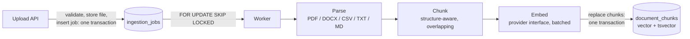
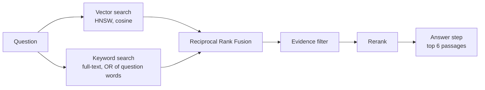

# AI design: ingestion, retrieval and answers

How documents become searchable knowledge (Phase 3), and how questions are answered from them with citations (Phase 4). Measured quality is in [Evaluation](#evaluation).

## Pipeline

1. **Upload** (`POST /documents`). Validation runs before anything is stored: the extension must be allowed, the content must match it (PDF magic bytes, a DOCX must be a zip containing `word/document.xml`, text must decode and contain no NUL bytes), the size must be under `NEXUS_MAX_UPLOAD_MB`, and a DOCX may not expand beyond 100 MB (zip-bomb guard). A SHA-256 of the file detects duplicates within the organization. The file, the document row, its version row, the ingestion job and the audit event are committed together.
2. **Parse** (worker). Text is extracted per PDF page (so chunks can cite pages), from DOCX paragraphs and tables, and from CSV rows. Each CSV row becomes a line like `name: Acme; region: EU; revenue: 100`, so a chunk is understandable without the header row. A PDF with no extractable text fails with "it may be a scanned image; OCR is not supported yet".
3. **Chunk.** Text is split on structure first (blank lines, Markdown headings), then sentences, and only hard-split as a last resort. Pieces are packed into chunks of up to `NEXUS_CHUNK_SIZE` characters (default 1,200, about 300 tokens), and each chunk starts with up to `NEXUS_CHUNK_OVERLAP` characters (default 200) from the end of the previous chunk, so a fact on a boundary is still found in one chunk. Each chunk records its page range.
4. **Embed.** Chunks are embedded in batches (`NEXUS_EMBEDDING_BATCH_SIZE`) through a provider interface.
5. **Store.** Old chunks of the document are deleted and the new ones inserted in **one transaction**, with the document row locked. Readers never see a half-processed document, and reprocessing gives the same result (idempotent).

## Embedding providers

Application code depends on an `EmbeddingProvider` interface (`backend/app/llm/embeddings.py`), not on a vendor SDK.

| Provider | `NEXUS_EMBEDDING_PROVIDER` | Use | Honest limits |
|---|---|---|---|
| Hashing | `hashing` (default) | Tests, CI, demos without an API key | Deterministic "hashing trick" over words and word pairs. Gives **lexical** similarity only: it is **not a semantic model** ("car" and "automobile" are unrelated to it). |
| OpenAI | `openai` | Real semantic embeddings | Needs `NEXUS_OPENAI_API_KEY`. Uses `text-embedding-3-small` at 1,536 dimensions by default. Any OpenAI-compatible endpoint works via `NEXUS_OPENAI_BASE_URL`. |

Errors are classified so the worker reacts correctly: timeouts, connection errors, HTTP 429 and 5xx are **retryable**; other 4xx (bad key, bad model) and malformed responses are **not**.

The vector size (1,536) is fixed in the schema. Every chunk stores the `embedding_model` that produced it; switching providers or models means reprocessing documents, because vectors from different models can't be compared.

## Storage for retrieval

Each chunk stores both representations Phase 4 needs for **hybrid retrieval**, in the same database:

| Column | Index | Purpose |
|---|---|---|
| `embedding vector(1536)` | HNSW, cosine distance | Semantic (vector) search |
| `tsv tsvector` (generated by PostgreSQL from `content`) | GIN | Keyword search; can never drift from the content |
| `organization_id`, plus the document's `min_role` | B-tree | Tenant and permission filtering **before** ranking |

## Permissions

Every document has a `min_role` (everyone / managers and admins / admins only). It is applied in the database query, so a document a user can't see is never listed, never returned by ID (404) and, in Phase 4, never retrieved as context for an answer. Nobody can set a document above their own role.

## Retrieval (Phase 4)

1. **Permission filter first.** Both searches run inside SQL with `organization_id = caller's org`, `min_role` within the caller's role, and `status = 'ready'`. A document the caller can't open can't influence ranking, appear in results, or be used for an answer.
2. **Vector search** returns the 30 nearest chunks (`NEXUS_RETRIEVAL_CANDIDATES`). `hnsw.ef_search` is raised to 200 per query because HNSW applies filters after the index scan; a wider scan keeps enough rows for one tenant.
3. **Keyword search** turns the question into its stemmed words joined with OR, so a natural question ("how many days of leave do we get?") still matches "24 days of paid leave". Ranked with `ts_rank_cd`.
4. **Reciprocal Rank Fusion** (k = 60) merges both lists by rank position, so their incompatible scores never need to be compared.
5. **Evidence filter.** A passage only counts if it matched keywords or its cosine similarity is at least `NEXUS_RETRIEVAL_MIN_SIMILARITY` (0.3). If nothing is left, the answer is "no evidence" and no model is called.
6. **Rerank.** Half the score is the fused rank, half is how much of the question's content words the passage covers. This is a heuristic, not a cross-encoder model; the reranker is one function, so a model can replace it later.

## Answers with citations

| Mode | `NEXUS_ANSWER_PROVIDER` | How it answers | Trade-off |
|---|---|---|---|
| Extractive | `extractive` (default) | No language model. Quotes up to 3 sentences that cover **more than half** of the question's content words, each followed by its source number. | Can't paraphrase or combine facts, so it refuses questions phrased differently from the documents (see evaluation), but it can't state anything the documents don't say. Runs offline, free, about 10 ms. |
| LLM | `openai` | An OpenAI-compatible chat model (`NEXUS_CHAT_MODEL`, default `gpt-4o-mini`) writes the answer from the numbered sources, at temperature 0. | Real paraphrasing and follow-ups; costs tokens and depends on the provider. |

Rules applied to LLM output, in code, not just in the prompt:

- The model must answer only from the sources and reply `INSUFFICIENT_EVIDENCE` otherwise; that reply becomes a "no evidence" answer.
- Every citation `[n]` must point to a source that was actually given. Made-up citation numbers are removed, and an answer with **no valid citation is treated as "no evidence"**, because it isn't grounded.
- Token usage, model name and latency are stored with each answer (for cost tracking in Phase 8).
- Provider errors: timeouts, 429 and 5xx return **503** ("try again"), other errors **502**. Nothing is saved, and provider details never reach the user.

**Prompt injection.** Documents are untrusted. Each passage is wrapped in its own `<source id="n">` block, any `</source>` inside the text is neutralised so a document can't close its block early, and the system prompt says text inside sources is information, never instructions. This reduces the risk but can't remove it; the stronger protection is architectural: the chat can only read documents the user is already allowed to see, and it can't take actions (agents with approval gates arrive in Phase 5).

**Follow-up questions.** In LLM mode the last 6 messages of the conversation are sent as history, so "and for managers?" makes sense. Retrieval uses the new question only, so a very short follow-up can retrieve weaker passages; query rewriting is a possible improvement.

## Conversations and privacy

- A conversation belongs to the user who started it; nobody else, including org admins, can read, rename or delete it (404).
- Each answer stores its citations (document, chunk, pages, a 600-character snippet). Whenever a conversation is opened, citations are **re-checked against current permissions**: if the document was deleted or restricted above the reader's role, the citation shows as "no longer available" and its snippet is withheld. The answer text itself is kept, since it's the user's own history.
- Questions are rate-limited per user (`NEXUS_CHAT_RATE_LIMIT_PER_USER`, 30 per minute) with Redis.

## Evaluation

`backend/tests/test_rag_eval.py` runs a small benchmark from `backend/evals/` through the real API (upload → worker → search → ask) with the default offline setup (hashing embeddings + extractive answers). It runs in CI.

The benchmark has 5 synthetic company documents and three groups of questions:

- 22 answerable questions, each with the document that holds the answer and a phrase the answer must contain.
- 6 questions the documents can't answer.
- 8 paraphrased questions that avoid the documents' wording. These were written **after** tuning, as a held-out check.

Latest run (24 Nov 2026):

| Metric | Result |
|---|---|
| Retrieval hit@1 (right document ranked first) | 22/22 (100%) |
| Retrieval hit@3 | 22/22 (100%) |
| Correct answer with a citation to the right document | 22/22 (100%) |
| Unanswerable questions correctly refused | 6/6 (100%) |
| Paraphrased: right document in top 3 | 7/8 (88%) |
| Paraphrased: answered correctly | **0/8 (0%)** |
| Paraphrased: answered **wrongly** | 0/8 |

**How to read this honestly.**

- The first two groups are optimistic. The extractive threshold was tuned on them: at the first setting (50% coverage) the benchmark caught 2 wrong answers to unanswerable questions, which led to the current setting. The questions also share the documents' vocabulary.
- The paraphrased group shows the real limit of the offline mode. Retrieval mostly still finds the right document, but the extractive answerer refuses rather than guesses. That is safe (no wrong answers), but not useful for questions phrased differently from the documents. This is what the LLM mode with real embeddings is for.
- LLM mode is tested for behaviour (prompt, citation checks, refusals, errors) against a mocked API, but its answer quality has **not been measured** here, because no real API key was used.
- 36 questions over 5 short documents is a smoke-level benchmark, not a statistically meaningful one.

## Known limitations

- No OCR: scanned PDFs fail with a clear reason.
- Chunk sizes are in characters, not model tokens (about 4 characters per token for English).
- Tables in PDFs come out as plain text in reading order; structure isn't preserved.
- The default hashing embedder isn't semantic; use the OpenAI provider for meaningful semantic search.
- The default extractive answerer only answers questions phrased close to the documents (see the evaluation).
- No streaming: answers arrive in one response. Fine for extractive mode, but noticeable for long LLM answers.
- Reranking is heuristic, not a cross-encoder model.
