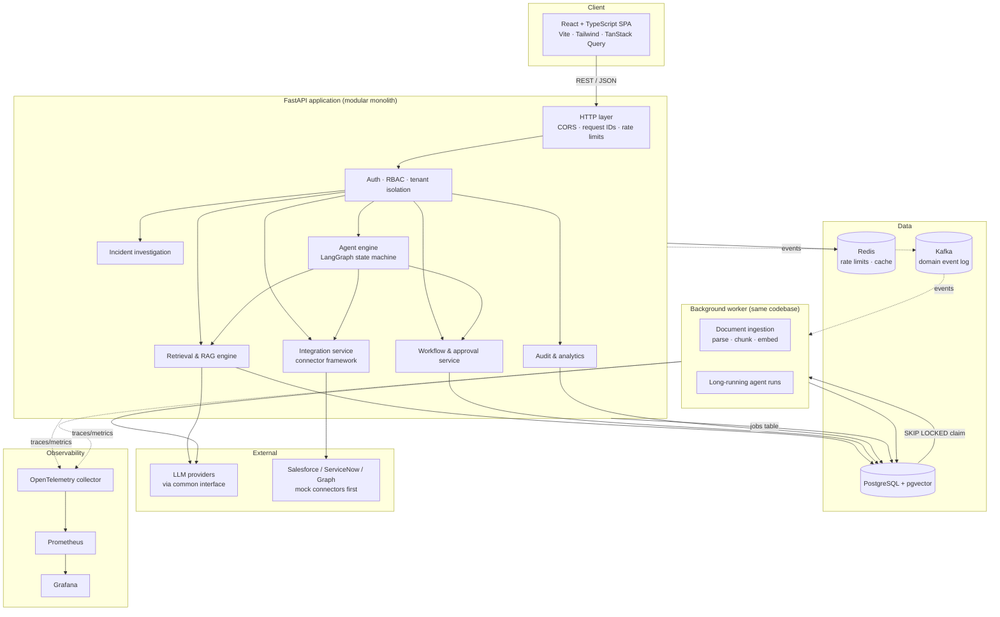
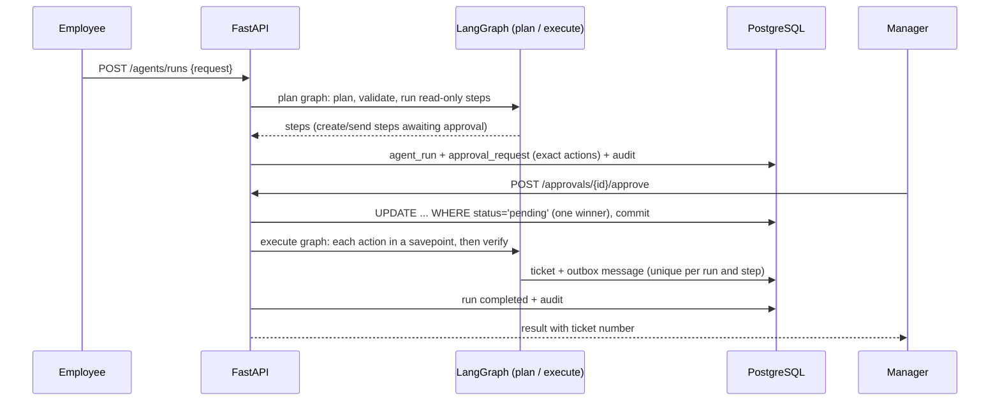
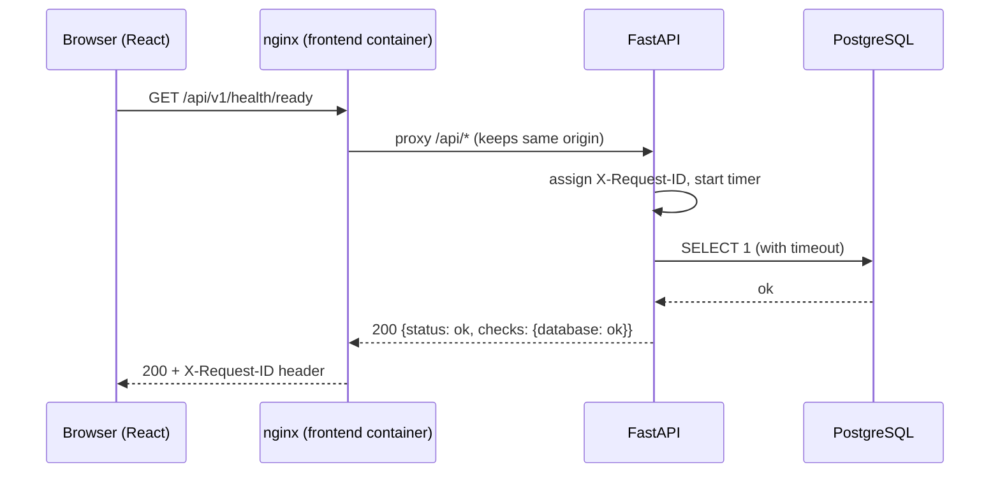

# NexusAI Architecture

## High-level view



## Component responsibilities

| Component | Responsibility | Phase |
|---|---|---|
| Frontend | Dashboard, chat workspace, documents, approvals, admin, observability pages | 1 → 10 |
| HTTP layer | Routing, CORS, request/correlation IDs, error envelope, rate limiting | 1 (IDs), 3 (rate limits) |
| Auth / RBAC / tenancy | Users, orgs, roles, JWT access + refresh tokens, tenant-scoped queries | 2 |
| Document intelligence | Upload validation, text + metadata extraction, chunking, embeddings, versioning, dedupe | 3 |
| RAG engine | Query preprocessing, hybrid retrieval, permission filtering, reranking, cited answers, "insufficient evidence" responses | 4 |
| Agent engine | LangGraph state machine: intent → plan → tool selection → approval gate → execution → validation | 5 |
| Workflow & approvals | Pending / approved / rejected / expired approvals, ownership, history | 5 |
| Integration service | Connector interface, OAuth2/token storage, health checks, retries, rate-limit handling, webhooks | 6 |
| Event layer | Event schemas, validation, idempotent consumers, retries, dead-letter queue | 7 |
| Audit & analytics | Append-only audit log of security-relevant and AI actions | 2+ |
| Observability | OTel traces and metrics (app, AI, infra), Grafana dashboards | 8 |
| Incident investigation | Gathers traces/logs/metrics, builds a timeline, separates evidence from AI hypotheses, retrieves runbooks | 9 |

## Document ingestion flow (Phase 3)

```mermaid
sequenceDiagram
    participant B as Browser
    participant A as FastAPI
    participant S as File storage (volume)
    participant D as PostgreSQL
    participant W as Worker
    participant E as Embedding provider

    B->>A: POST /documents (multipart)
    A->>A: validate type, content, size; sha256 duplicate check
    A->>S: write original file
    A->>D: INSERT document, version, job, audit event (one transaction)
    A-->>B: 201 {status: queued}
    loop every second
        W->>D: claim next job (FOR UPDATE SKIP LOCKED)
    end
    W->>S: read file
    W->>W: parse → chunk
    W->>E: embed chunks (batched)
    W->>D: replace chunks + mark ready (one transaction)
    B->>A: GET /documents/{id} (polls while queued/processing)
    A-->>B: {status: ready, chunk_count}
```

Details: [`ai-design.md`](ai-design.md) (pipeline) and [`operations.md`](operations.md) (running the worker).

## Agent approval flow (Phase 5)



Details: [`agents-design.md`](agents-design.md).

## Question answering flow (Phase 4)

```mermaid
sequenceDiagram
    participant B as Browser
    participant A as FastAPI
    participant D as PostgreSQL
    participant L as Answer provider

    B->>A: POST /chat/ask {question, conversation_id?}
    A->>A: per-user rate limit (Redis)
    A->>A: embed the question
    A->>D: vector search + keyword search<br/>(org, role and status filters inside SQL)
    A->>A: fuse (RRF), evidence filter, rerank
    alt no evidence
        A->>A: "I couldn't find this", no model call
    else evidence
        A->>L: numbered sources + question (+ history)
        L-->>A: answer with [n] citations
        A->>A: drop invalid citations; no valid citation = no evidence
    end
    A->>D: save question + answer (citations, model, tokens, latency)
    A-->>B: answer with clickable citations
```

## Request flow (Phase 1)



## Key design decisions

1. **Modular monolith first.** One FastAPI app with clear module boundaries is faster to build, test and deploy than ten microservices, and it is what most real enterprise AI products start as. The worker is a separate *process* from the same codebase so slow work never blocks API requests.
2. **Async SQLAlchemy 2.0 + asyncpg.** The API spends most of its time waiting on the database and LLM providers; async I/O keeps one process responsive under concurrent requests.
3. **Liveness vs readiness.** `/health/live` never touches dependencies (is the process up?). `/health/ready` checks PostgreSQL with a timeout (can it serve traffic?). Orchestrators like ECS/Kubernetes use these differently: a failing readiness check stops traffic, a failing liveness check restarts the container.
4. **Request IDs from day one.** Every response carries `X-Request-ID`, and every log line includes it. Phase 8 links the same ID to OpenTelemetry trace IDs, so a request can be followed across the API, RAG pipeline, agents and connectors.
5. **Configuration through environment variables** (pydantic-settings), validated at startup. Secrets never live in the repo; `.env.example` documents every variable.
6. **Same-origin API in Docker.** nginx serves the built frontend and proxies `/api` to the backend, so the browser never needs CORS in the containerised setup. CORS is still configured for the Vite dev server.
7. **Provider-agnostic AI layer.** Application code depends on an interface, not on one vendor's SDK; a deterministic offline provider keeps tests and demos runnable without API keys. Embeddings use it since Phase 3; chat models join in Phase 4.
8. **PostgreSQL as the job queue, Redis for rate limits only (Phase 3).** Jobs are written in the same transaction as the upload, so work can't be lost or orphaned, and a Redis outage never stops ingestion or logins (the rate limiter fails open).
