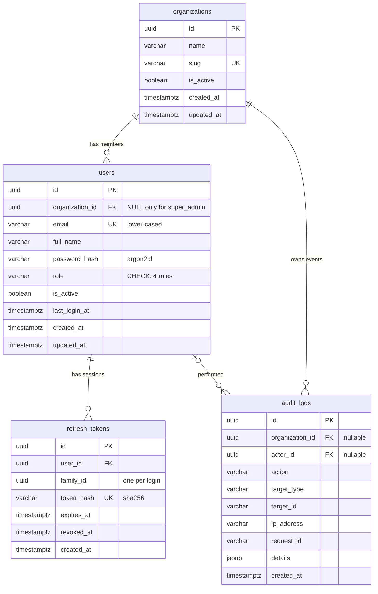

# Database design

PostgreSQL 16 is the system of record. Schema changes are made only through Alembic migrations in `backend/alembic/versions/`, and a test (`alembic check`) fails if the ORM models drift from the migrations.

## Current schema (Phase 2)

## Constraints

| Table | Constraint | Purpose |
|---|---|---|
| users | `CHECK role IN ('super_admin','org_admin','manager','employee')` | Invalid roles can't be stored, even by a bug. |
| users | `CHECK (role = 'super_admin') = (organization_id IS NULL)` | Every user belongs to exactly one tenant, except the platform super admin, who belongs to none. |
| users | `UNIQUE (email)` | Login needs only email and password. |
| organizations | `UNIQUE (slug)` | Stable, URL-safe identifier. |
| refresh_tokens | `UNIQUE (token_hash)` | Fast, unambiguous lookup on refresh. |
| all | Foreign keys, `ON DELETE CASCADE` from organizations | Deleting a tenant removes all its data; no orphans. |
| audit_logs.actor_id | `ON DELETE SET NULL` | The audit trail survives user deletion. |

## Indexes

| Index | Used by |
|---|---|
| `users (organization_id, created_at)` | Tenant user list, ordered by join date. |
| `audit_logs (organization_id, created_at)` | Tenant audit log, newest first, paginated. |
| `refresh_tokens (family_id)` | Revoking a whole session family on reuse or logout. |
| `refresh_tokens (user_id)` | Revoking all sessions when a user is deactivated. |

**Tenant-first composite indexes** are the rule for every tenant-owned table: almost every query starts with `WHERE organization_id = :caller_org`.

## Design decisions

1. **UUID primary keys.** IDs can't be guessed or used to estimate another tenant's row counts, and they can be generated before insert.
2. **Roles as a constrained column, not a permissions table.** The product has four well-defined personas; a fixed set is simpler to audit and test. Endpoints depend on `require_roles(...)`, so introducing a permissions table later doesn't change callers.
3. **Globally unique email.** One person signs in with just email and password, with no "which organization?" step. Trade-off: one email can't belong to two organizations. This is acceptable for this product and can be revisited with an org picker.
4. **Refresh tokens stored as hashes in their own table.** This allows rotation, reuse detection by family, and per-user revocation. A database leak doesn't expose usable tokens.
5. **Audit details as JSONB.** Each event type has different details (before/after values for updates, reasons for failures) without schema changes per event.
6. **Timestamps with time zone, set by the database** (`now()`), so they are consistent regardless of server clock or time zone.

## Coming next

| Phase | Tables |
|---|---|
| 3 | `documents`, `document_versions`, `document_chunks` (pgvector `embedding` + `tsvector` for hybrid search; HNSW and GIN indexes) |
| 4 | `conversations`, `messages` (citations as JSONB) |
| 5 | `agent_definitions`, `tool_definitions`, `agent_executions`, `workflow_runs`, `approval_requests` |
| 6 | `integrations`, `integration_credentials` (encrypted at rest) |
| 7 | `system_events` (unique idempotency key) |
| 9 | `incidents` |
