# Database design

PostgreSQL 16 is the system of record. Schema changes are made only through Alembic migrations in `backend/alembic/versions/`, and a test (`alembic check`) fails if the ORM models drift from the migrations.

## Current schema (Phases 2–6)

```mermaid
erDiagram
    organizations ||--o{ users : "has members"
    organizations ||--o{ audit_logs : "owns events"
    users ||--o{ refresh_tokens : "has sessions"
    users |o--o{ audit_logs : "performed"
    organizations ||--o{ documents : "owns"
    documents ||--|{ document_versions : "has"
    documents ||--o{ document_chunks : "split into"
    document_versions ||--o{ document_chunks : "produced"
    documents ||--o{ ingestion_jobs : "processed by"
    users ||--o{ conversations : "owns"
    conversations ||--o{ messages : "contains"
    users ||--o{ agent_runs : "requests"
    agent_runs ||--o| approval_requests : "waits for"
    agent_runs ||--o{ tickets : "creates"
    agent_runs ||--o{ outbox_messages : "records"
    organizations ||--o{ integrations : "connects"
    integrations ||--o{ integration_calls : "logs"
    integrations ||--o{ webhook_events : "receives"

    organizations {
        uuid id PK
        varchar name
        varchar slug UK
        boolean is_active
        timestamptz created_at
        timestamptz updated_at
    }
    users {
        uuid id PK
        uuid organization_id FK "NULL only for super_admin"
        varchar email UK "lower-cased"
        varchar full_name
        varchar password_hash "argon2id"
        varchar role "CHECK: 4 roles"
        boolean is_active
        timestamptz last_login_at
        timestamptz created_at
        timestamptz updated_at
    }
    refresh_tokens {
        uuid id PK
        uuid user_id FK
        uuid family_id "one per login"
        varchar token_hash UK "sha256"
        timestamptz expires_at
        timestamptz revoked_at
        timestamptz created_at
    }
    audit_logs {
        uuid id PK
        uuid organization_id FK "nullable"
        uuid actor_id FK "nullable"
        varchar action
        varchar target_type
        varchar target_id
        varchar ip_address
        varchar request_id
        jsonb details
        timestamptz created_at
    }
    documents {
        uuid id PK
        uuid organization_id FK
        uuid uploaded_by FK
        varchar title
        varchar file_type "CHECK"
        varchar min_role "CHECK: who may see it"
        varchar status "queued/processing/ready/failed"
        int current_version
        int chunk_count
        int page_count
        varchar error "safe for users"
        jsonb metadata
        timestamptz processed_at
    }
    document_versions {
        uuid id PK
        uuid document_id FK
        uuid organization_id FK
        int version "UNIQUE per document"
        varchar original_filename
        varchar storage_key
        bigint size_bytes
        varchar sha256 "UNIQUE per organization"
    }
    document_chunks {
        uuid id PK
        uuid document_id FK
        uuid version_id FK
        uuid organization_id FK
        int chunk_index "UNIQUE per document"
        text content
        int page_start
        int page_end
        vector embedding "1536, HNSW cosine"
        varchar embedding_model
        tsvector tsv "GENERATED, GIN"
    }
    ingestion_jobs {
        uuid id PK
        uuid document_id FK
        uuid version_id FK
        varchar status "queued/running/done/failed/superseded"
        int attempts
        timestamptz run_after "backoff"
        timestamptz locked_at "crash recovery"
        varchar worker_id
        varchar last_error "internal"
    }
    conversations {
        uuid id PK
        uuid organization_id FK
        uuid user_id FK "only the owner can read it"
        varchar title
        timestamptz updated_at
    }
    messages {
        uuid id PK
        uuid conversation_id FK
        uuid organization_id FK
        varchar role "user/assistant"
        text content
        varchar status "answered/no_evidence"
        jsonb citations "document, chunk, pages, snippet"
        varchar model
        int input_tokens
        int output_tokens
        int latency_ms
    }
    agent_runs {
        uuid id PK
        uuid organization_id FK
        uuid requested_by FK
        text request
        varchar status "CHECK: 6 states"
        varchar planner
        jsonb steps "tool, args, status, result"
        text summary
    }
    approval_requests {
        uuid id PK
        uuid agent_run_id FK "UNIQUE"
        varchar status "pending/approved/rejected/expired"
        jsonb actions "exact snapshot"
        uuid requested_by FK
        uuid decided_by FK
        varchar comment
        timestamptz expires_at
    }
    tickets {
        uuid id PK
        uuid organization_id FK
        int number "UNIQUE per org"
        varchar title
        varchar priority "CHECK"
        varchar customer_email
        uuid agent_run_id FK
        int step_index "UNIQUE with run"
        varchar external_system "servicenow"
        varchar external_id
        varchar external_number "INC..."
    }
    outbox_messages {
        uuid id PK
        uuid organization_id FK
        varchar recipient
        varchar subject
        text body
        varchar status "recorded or sent"
        varchar provider_message_id
        uuid agent_run_id FK
        int step_index "UNIQUE with run"
    }
    integrations {
        uuid id PK
        uuid organization_id FK "UNIQUE with kind"
        varchar kind "servicenow/salesforce/email"
        varchar base_url "allowlisted host"
        jsonb config
        text secrets_encrypted "Fernet"
        text webhook_secret_encrypted
        varchar status
        varchar health_status
    }
    integration_calls {
        uuid id PK
        uuid integration_id FK
        varchar operation
        varchar outcome
        int http_status
        int attempts
        int latency_ms
    }
    webhook_events {
        uuid id PK
        uuid integration_id FK
        varchar event_id "UNIQUE with integration"
        varchar event_type
        jsonb payload
    }
```

## Constraints

| Table | Constraint | Purpose |
|---|---|---|
| users | `CHECK role IN ('super_admin','org_admin','manager','employee')` | Invalid roles can't be stored, even by a bug. |
| users | `CHECK (role = 'super_admin') = (organization_id IS NULL)` | Every user belongs to exactly one tenant, except the platform super admin, who belongs to none. |
| users | `UNIQUE (email)` | Login needs only email and password. |
| organizations | `UNIQUE (slug)` | Stable, URL-safe identifier. |
| refresh_tokens | `UNIQUE (token_hash)` | Fast, unambiguous lookup on refresh. |
| all | Foreign keys, `ON DELETE CASCADE` from organizations | Deleting a tenant removes all its data; no orphans. |
| audit_logs.actor_id | `ON DELETE SET NULL` | The audit trail survives user deletion. |
| document_versions | `UNIQUE (organization_id, sha256)` | Duplicate uploads are detected even when two arrive at the same moment. |
| documents | `CHECK` on `status`, `file_type`, `min_role` | Only known values can be stored. |
| documents → versions, chunks, jobs | `ON DELETE CASCADE` | Deleting a document removes everything derived from it in one statement. |
| approval_requests | `UNIQUE (agent_run_id)` | One approval per run. |
| tickets, outbox_messages | `UNIQUE (agent_run_id, step_index)` | An approved action can never create its record twice, even when retried. |
| tickets | `UNIQUE (organization_id, number)` | Human-friendly ticket numbers that can't collide (allocated under a per-organization advisory lock). |
| integrations | `UNIQUE (organization_id, kind)` | One connection per system, so tools know which to use. |
| webhook_events | `UNIQUE (integration_id, event_id)` | A redelivered webhook is recorded and applied once. |
| document_chunks.tsv | `GENERATED ALWAYS AS (to_tsvector('english', content)) STORED` | Keyword index can never drift from the text. |

## Indexes

| Index | Used by |
|---|---|
| `users (organization_id, created_at)` | Tenant user list, ordered by join date. |
| `audit_logs (organization_id, created_at)` | Tenant audit log, newest first, paginated. |
| `refresh_tokens (family_id)` | Revoking a whole session family on reuse or logout. |
| `refresh_tokens (user_id)` | Revoking all sessions when a user is deactivated. |
| `documents (organization_id, created_at)` | Tenant document list, newest first. |
| `document_chunks USING hnsw (embedding vector_cosine_ops)` | Approximate nearest-neighbour (semantic) search, Phase 4. |
| `document_chunks USING gin (tsv)` | Full-text (keyword) search, Phase 4. |
| `ingestion_jobs (status, run_after)` | The worker's "next runnable job" query. |
| `conversations (user_id, updated_at)` | A user's chat list, most recent first. |
| `messages (conversation_id, created_at)` | Loading one conversation in order. |
| `agent_runs (organization_id, created_at)`, `agent_runs (requested_by)` | Run lists for managers, and for each employee. |
| `approval_requests (organization_id, status)` | The pending-approvals queue. |
| `integration_calls (integration_id, created_at)` | Recent calls on the Integrations page. |
| `tickets (external_system, external_id)` | Finding the ticket a webhook is about. |

**Tenant-first composite indexes** are the rule for every tenant-owned table: almost every query starts with `WHERE organization_id = :caller_org`.

## Design decisions

1. **UUID primary keys.** IDs can't be guessed or used to estimate another tenant's row counts, and they can be generated before insert.
2. **Roles as a constrained column, not a permissions table.** The product has four well-defined personas; a fixed set is simpler to audit and test. Endpoints depend on `require_roles(...)`, so introducing a permissions table later doesn't change callers.
3. **Globally unique email.** One person signs in with just email and password, with no "which organization?" step. Trade-off: one email can't belong to two organizations. This is acceptable for this product and can be revisited with an org picker.
4. **Refresh tokens stored as hashes in their own table.** This allows rotation, reuse detection by family, and per-user revocation. A database leak doesn't expose usable tokens.
5. **Audit details as JSONB.** Each event type has different details (before/after values for updates, reasons for failures) without schema changes per event.
6. **Timestamps with time zone, set by the database** (`now()`), so they are consistent regardless of server clock or time zone.
7. **PostgreSQL as the job queue.** The job row is inserted in the same transaction as the upload, so a document can't exist without its job; workers claim jobs with `FOR UPDATE SKIP LOCKED`. Redis or Kafka would add a second system that can disagree with the database. At much higher volume, a dedicated queue becomes worth it (Phase 7 introduces Kafka for domain events).
8. **pgvector instead of a separate vector database.** Vectors, keywords, tenant IDs and permissions live in one database, so filtering by organization and role happens in the same query as the similarity search, and there's one system to back up.

## Coming next

| Phase | Tables |
|---|---|
| 7 | `system_events` (unique idempotency key) |
| 9 | `incidents` |
