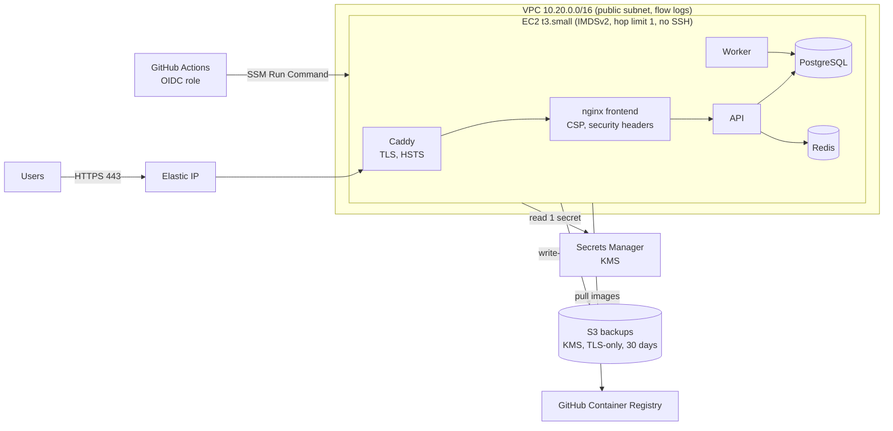
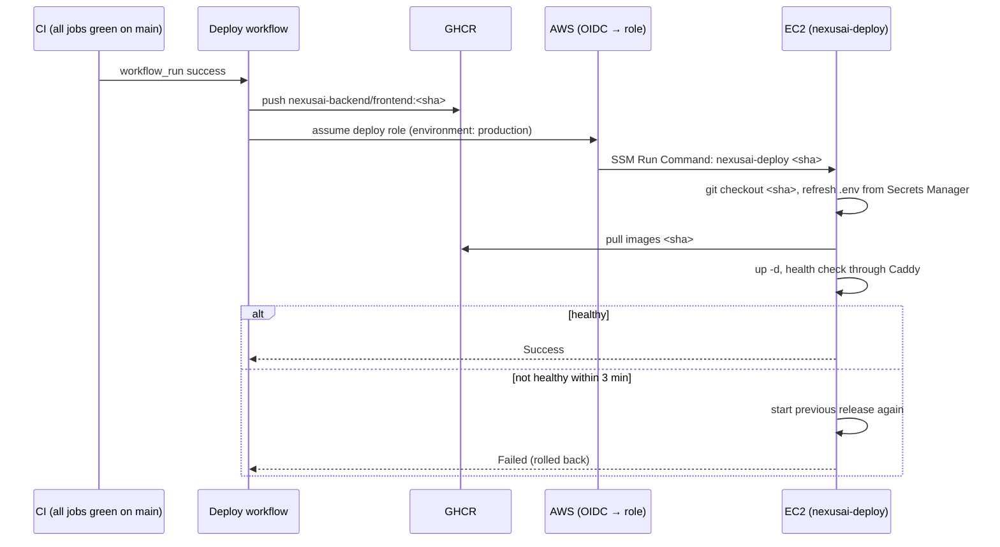

# Deployment (Phase 10)

NexusAI ships with two deployment targets:

| Target | What it is | Status |
|---|---|---|
| **Single server on AWS** | Terraform creates one EC2 instance running the Docker Compose production stack behind Caddy (automatic HTTPS). GitHub Actions publishes images and deploys each commit with an automatic rollback. | Terraform is validated and tested with **mocked AWS providers**. The stack and the deploy/rollback script run for real in CI. It has **not been applied to a real AWS account**. |
| **Kubernetes** | Kustomize manifests: a base, a `kind` overlay (local/CI) and an example `production` overlay (EKS-style). | CI deploys to a real **kind** cluster, runs the end-to-end smoke test, proves the network policies are enforced, and rolls back a bad release. The production overlay is only rendered and schema-checked. |

Nothing here needs a cloud account to verify. Every check below runs in GitHub Actions.

## Single server on AWS



### What Terraform creates (`infra/terraform/aws`)

| Resource | Security decisions |
|---|---|
| VPC, public subnet, internet gateway, **flow logs** (1 year) | The default security group is taken over and left with no rules. |
| Security group | In: **443/tcp, 443/udp (HTTP/3), 80/tcp** (redirect and Let's Encrypt only). **No SSH.** Out: **443 only**. |
| EC2 instance (Amazon Linux 2023) | **IMDSv2 required, hop limit 1**, so containers can't read the instance's credentials (this blocks the classic SSRF-to-metadata attack). Encrypted root disk. Detailed monitoring. Admin access goes through **SSM Session Manager**, which uses IAM and is logged. |
| Separate **data volume** (EBS, KMS) | Docker data (PostgreSQL, uploads, certificates), the code checkout and the deployed-release marker. Replacing the instance keeps all data, and the replacement starts the release that was running before. |
| Elastic IP, optional Route 53 record | |
| **KMS key** (yearly rotation) | Encrypts the secret, both disks and the backups. |
| **Secrets Manager** secret | Generated database and Redis passwords, JWT secret and Fernet encryption key (plus an optional OpenAI key). Nobody types them, and they're not in git or in user data (a test checks the user data). |
| Instance IAM role | Read **that one secret**. Write, but not read, backups. Use the key only through Secrets Manager and S3. SSM core. A test checks there are no wildcard actions. |
| S3 backup bucket | Private (all public access blocked), KMS-encrypted, versioned, **TLS-only** policy, expires after `backup_retention_days`. |
| GitHub deploy role (optional) | **OIDC, no stored AWS keys.** Only `repo:<owner>/<repo>:environment:production` can assume it. It can only run `AWS-RunShellScript` on this one instance. |

### First deployment

You need an AWS account, a domain you control, OpenTofu ≥ 1.6 or Terraform ≥ 1.6, and CI having published images for a commit (the **Deploy** workflow does that on every green `main`). If the repository or its packages are private, make the two GHCR packages public, or add registry credentials on the server.

```bash
cd infra/terraform/aws
cp terraform.tfvars.example terraform.tfvars   # fill in domain, email, repo, image tag
tofu init
tofu plan                                      # review
tofu apply
```

1. Point the domain's **A record** to the `public_ip` output (automatic with `route53_zone_id`).
2. The instance boots, mounts the data volume, installs Docker and Compose (checksum verified), clones the repository, writes `deploy/.env` from Secrets Manager (`chmod 600`), and runs `deploy/deploy.sh <image_tag>`. Progress: `/var/log/nexusai-bootstrap.log` (open a shell with `aws ssm start-session --target <instance_id>`).
3. Caddy gets a Let's Encrypt certificate as soon as DNS points to the server.
4. Public sign-up is off. Create the first organization by temporarily setting `allow_public_signup = true`, or use the super-admin CLI: `docker compose -f deploy/docker-compose.prod.yml exec backend python -m app.cli create-superadmin`.

**Cost:** roughly one t3.small, 50 GB of gp3, one KMS key, one secret, an Elastic IP and a little S3/CloudWatch. Check current AWS pricing for your region; free-tier eligibility changes over time.

### Continuous deployment



To turn it on, set the repository variables `AWS_DEPLOY_ROLE_ARN`, `AWS_INSTANCE_ID` and `AWS_REGION` (Terraform outputs) and create a GitHub environment called `production`. Add required reviewers there for a manual approval gate. Until the variables exist, the deploy job is skipped and only images are published. You can also redeploy any published commit with **Run workflow** and its SHA.

### Rollback, and why migrations matter

`deploy/deploy.sh` remembers the last healthy release. If a new one isn't healthy (page **and** `/api/v1/health/ready`, through Caddy) within `HEALTH_TIMEOUT_SECONDS`, it starts the previous one and exits 1. If that is unhealthy too, it exits 2 for a person to look at. Tested with fakes in `deploy/tests` and for real in CI (`production-stack` job: a release with missing images is rolled back).

Rolling back the **code** doesn't roll back the **database**. Migrations run when the new backend starts, so every migration must work with the previous release: add a column or table first, and remove the old one in a later release (expand, then contract). The Kubernetes init container (`python -m app.db.schema_check`) accepts a schema newer than the code for exactly this reason.

### Backups and restore

A systemd timer runs `deploy/backup.sh` nightly (02:00 IST). It streams `pg_dump --format=custom` and a tar of the uploads straight to S3. A failed dump fails the job and deletes the partial object, so a truncated file never looks like a backup (tested). The server can't read backups. Restore with administrator credentials:

```bash
aws s3 cp s3://<bucket>/db/<stamp>.dump - | \
  docker compose -f deploy/docker-compose.prod.yml exec -T db pg_restore -U nexus -d nexusai --clean --if-exists
aws s3 cp s3://<bucket>/uploads/<stamp>.tar.gz - | \
  docker compose -f deploy/docker-compose.prod.yml exec -T backend tar -xzf - -C /data/uploads
```

Restores haven't been rehearsed against real S3 (no AWS account was used). Practise one before relying on it.

### Rotating secrets

The Secrets Manager secret has no automatic rotation: rotating the encryption key needs re-encryption of stored integration credentials, and rotating the JWT secret signs everyone out. To rotate manually, update the value in Secrets Manager, then redeploy the current SHA (the deploy re-reads the secret). Database password rotation also needs `ALTER USER nexus PASSWORD …` first.

## Production stack (`deploy/docker-compose.prod.yml`)

| | Development (`docker-compose.yml`) | Production |
|---|---|---|
| Entry point | nginx on :5173, API on :8000, DB on :5432 | **Caddy on 80/443 only**. API, database and Redis have no published ports. |
| TLS | none | Let's Encrypt via Caddy, HTTP→HTTPS redirect, **HSTS**, `Server` header removed |
| Networks | one | `edge` (Caddy, frontend), `app` (frontend, API, worker), `data` **internal, no internet** (database, Redis, API, worker) |
| Containers | defaults | **read-only root filesystems**, `cap_drop: ALL`, `no-new-privileges`, tmpfs for /tmp, non-root (API uid 10001, nginx uid 101) |
| Settings | dev defaults | `NEXUS_ENVIRONMENT=production`: startup refuses dev secrets, the default database password and insecure cookies. Public sign-up off. Redis requires a password. |
| Images | built locally | pulled by tag (commit SHA), so a rollback is just an older tag |
| Mock systems | always | only with `--profile demo` |

Security headers come from the frontend's nginx (`frontend/nginx/security-headers.conf`): a strict **Content-Security-Policy** (`default-src 'self'`, no inline scripts, `frame-ancestors 'none'`), `X-Frame-Options: DENY`, `nosniff`, `Referrer-Policy` and `Permissions-Policy`. The API adds `Cache-Control: no-store` and `nosniff` to every response. Every page was browsed under this policy with zero CSP violations (Playwright, Phase 10 verification).

## Kubernetes (`deploy/k8s`)

| Object | Notes |
|---|---|
| `nexusai-migrate` Job | Runs `alembic upgrade head` once per release. API/worker pods wait for the schema in an init container instead of migrating in every replica (that would race). |
| `backend` Deployment (2 replicas) + Service | `maxUnavailable: 0`, so a broken release never reduces capacity. Startup/readiness (includes the database)/liveness (process only) probes. |
| `worker` Deployment | Heartbeat-file probes; 120 s grace period to finish the current job. |
| `frontend` Deployment (2) + Service | Unprivileged nginx. |
| Pod security | Namespace enforces the **restricted** Pod Security Standard. Every pod is non-root with a read-only root filesystem, drops all capabilities, uses seccomp `RuntimeDefault` and gets **no service account token**. |
| **Network policies** | Default deny in and out. DNS allowed. Ingress→frontend:8080→backend:8000. Backend image→5432/6379. Outbound HTTPS **except 169.254.169.254** (cloud metadata). |
| PDBs, HPA | At least one API and frontend pod during drains. API autoscaling on CPU 2→6 (needs metrics-server). |
| `overlays/kind` | Adds PostgreSQL (pgvector), Redis with a password, the mock systems, data-store network policies and throwaway secrets. |
| `overlays/production` | Example only: GHCR images, 3 API replicas, zone spreading, EFS (`ReadWriteMany`) for uploads, ingress-nginx and cert-manager TLS. Assumes RDS, ElastiCache and the Secret synced from Secrets Manager (e.g. External Secrets Operator). |

```bash
kind create cluster --name nexusai
docker build -t nexusai-backend:ci backend && docker build -t nexusai-frontend:ci frontend
kind load docker-image nexusai-backend:ci nexusai-frontend:ci --name nexusai
kubectl apply -k deploy/k8s/overlays/kind
kubectl -n nexusai port-forward svc/frontend 8080:80    # http://localhost:8080
```

Re-applying for a new release: `kubectl -n nexusai delete job nexusai-migrate`, then `kubectl apply -k …` again (Jobs are immutable). Helm would turn this into a pre-upgrade hook. Helm isn't used, to keep one templating tool.

## What CI verifies

| Job | Checks |
|---|---|
| `infra` | `tofu fmt`, `validate`, **`tofu test`** (9 security assertions with mocked providers, e.g. no SSH, IMDSv2 hop limit 1, no secrets in user data, least-privilege policies, TLS-only private bucket, deploy role scoped to one repo/environment/instance, input validation that blocks command injection through the image tag). Shellcheck of all scripts **and the rendered EC2 boot script**. `deploy/tests` (9 tests). Kustomize render + **kubeconform** (strict). **Checkov** on Terraform and the rendered manifests. |
| `production-stack` | Builds the images and starts the stack **with `deploy.sh`**. Checks HTTP→HTTPS, that only Caddy is reachable, and the headers. Runs the full smoke test **over HTTPS**, then deploys a broken release and checks it's **rolled back**. **Trivy** (fails on fixable CRITICAL, reports HIGH). **OWASP ZAP baseline** (fails on missing CSP, clickjacking protection, HSTS, `nosniff`, or version-leaking headers; report uploaded as an artifact). |
| `kubernetes` | **kind** cluster with restricted Pod Security. Migrate job, rollouts, smoke test through the frontend service, **network-policy enforcement probes** (allowed and denied connections), and a bad image that never takes the API down and is rolled back with `kubectl rollout undo`. |

Checkov exceptions are written next to the code (`#checkov:skip=…` with a reason) or in the CI step. They are: image digests (tags are commit SHAs), CPU limits (they cause throttling; memory limits are set), secrets as environment variables (12-factor settings), pull policy `Always` (kind uses preloaded images), and image-defined UIDs (nginx 101, postgres 999).

## Honest limits

- **No real AWS deployment.** Terraform is tested with mocked providers and Checkov. A real `apply` could still hit things mocks can't show (quotas, region-specific AMI availability, IAM propagation timing).
- **One server.** No high availability: the database is a container on the same machine, and an instance or zone failure means downtime until it's replaced (the data volume survives). RDS, several instances and a load balancer are the next step, sketched in the production Kubernetes overlay.
- **Single-AZ backups.** No cross-region replication of the backup bucket.
- The **Kubernetes production overlay** is an example that was never applied. Only the kind overlay runs.
- **Automatic secret rotation** isn't implemented (manual procedure above).
- **Trivy and ZAP run only in CI**, and their results depend on the base images on the day they run. The HIGH-severity report is informational.
