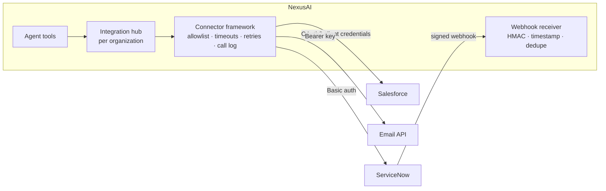

# Integrations (Phase 6)

NexusAI connects to the systems agents act on: **ServiceNow** (tickets), **Salesforce** (customer data) and **email** (Microsoft Graph style). In this repository they are **mock services with synthetic data** (`backend/app/mock_services`). They run as their own container and behave like the real APIs in the ways that matter for integration code: authentication, status codes, rate limits with `Retry-After`, idempotency keys and signed webhooks. No real company account is used.

## What each connection does

| System | Auth | Used by | Effect |
|---|---|---|---|
| ServiceNow | Basic auth | `create_ticket` | Creates an incident (`INC…`). The NexusAI ticket stores the incident's id, number and link. Resolving the incident in ServiceNow updates the ticket through a webhook. |
| Salesforce | OAuth 2.0 client credentials (token cached, refreshed on 401) | `lookup_customer` (new read-only tool) | The agent looks up the customer's name, account, tier and owner before acting |
| Email | Bearer API key | `notify_customer` | Approved emails are **actually sent** through the provider (status `sent`), instead of only being recorded in the outbox |

Without a connection, or with it disabled, tools fall back to internal records and say so in their result. Every connection is per organization, at most one of each kind.

## Connector framework

Every outbound call goes through one code path (`backend/app/modules/integrations/connectors.py`):

- **SSRF protection.** Base URLs must use http/https, contain no credentials, and point to a host in `NEXUS_INTEGRATION_ALLOWED_HOSTS`. A leading dot allows subdomains, e.g. `.service-now.com`. Redirects are not followed, so a redirect can't lead outside the allowlist. Tests cover cloud metadata IPs, internal hostnames, look-alike domains and `file://`.
- **Timeouts** on every call (`NEXUS_INTEGRATION_TIMEOUT_SECONDS`).
- **Retries** for timeouts, connection errors, 429 and 502/503/504, with exponential backoff and jitter. The server's `Retry-After` is honoured, capped at `NEXUS_INTEGRATION_MAX_RETRY_AFTER_SECONDS`. Other 4xx errors, such as a wrong password or invalid input, are **not** retried.
- **No duplicates on retry.** Creates send an `Idempotency-Key` derived from the agent run and step, so a retry after a timeout returns the same incident or email instead of creating a second one. This is tested both against the mock and through a full failed-then-retried run.
- **Call log.** Each logical call records its operation, outcome, HTTP status, number of attempts and latency. It's written in its own transaction, so failed calls are still logged when the agent step rolls back. It's shown on the Integrations page.

## Credentials

- Stored only encrypted (Fernet: AES with an HMAC, random IV per value) with `NEXUS_ENCRYPTION_KEY`. Staging and production refuse to start with the development key.
- Never returned by the API. Only the names of the fields that are set are shown (e.g. "password: ••••••").
- Write-only updates. The audit log records *which* fields changed, never their values (tested).

## Webhooks

`POST /api/v1/webhooks/servicenow/{integration_id}` accepts an event only if:

1. The integration exists, is a ServiceNow connection, and is active.
2. The body is at most 64 KB.
3. `X-NexusAI-Signature` equals HMAC-SHA256(secret, `"<timestamp>.<raw body>"`), compared in constant time.
4. `X-NexusAI-Timestamp` is within 5 minutes, which stops replays of captured requests.
5. The event id hasn't been seen before. Redeliveries return `{"status": "duplicate"}` and change nothing.

The signing secret is generated by NexusAI, shown **once** when the connection is created, and can be rotated. With the mock, NexusAI registers its webhook URL automatically. With a real ServiceNow, an admin would configure the URL and secret in an outbound REST message.

## Honest limits

- All three systems are **mocks**. The connectors follow the real APIs' shapes, but they have not been run against real ServiceNow, Salesforce or Microsoft Graph accounts. The Salesforce lookup is a simplified endpoint, not a real SOQL query.
- There's no circuit breaker: a system that's down is retried within each call, not paused across calls.
- One connection of each kind per organization.
- The mock delivers each webhook to every registered URL. That's a demo shortcut; NexusAI still only updates tickets of the organization that owns the integration (tested by construction, and visible in the end-to-end run).
- Email verification, password reset and SSO/MFA for NexusAI's own login are **not** part of this phase.
