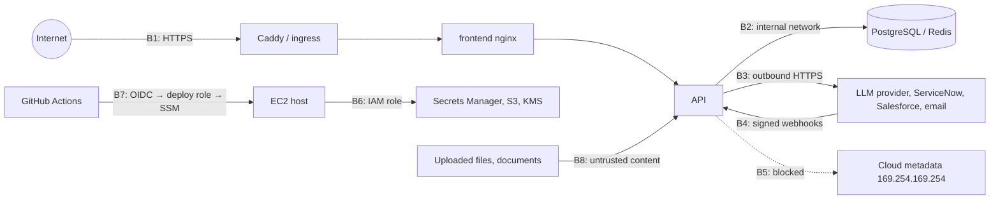

# Threat model

Scope: NexusAI as deployed by Phase 10 (single AWS server or Kubernetes), including the application controls from Phases 2–6. The method is STRIDE per trust boundary. Every mitigation listed as implemented is in the code and covered by a test or a CI check; the "Evidence" column says where. Application-level details are in [`security.md`](security.md); deployment details are in [`deployment.md`](deployment.md).

## What we protect

| Asset | Why it matters |
|---|---|
| Tenant documents, chunks, conversations | Confidential company knowledge; must never cross organizations or roles |
| Integration credentials (ServiceNow, Salesforce, email) | Access to other business systems |
| Session tokens and password hashes | Account takeover |
| Application secrets (JWT key, encryption key, database and Redis passwords) | Whoever holds these can forge sessions or decrypt credentials |
| Agent actions (tickets, emails) | Real side effects in other systems |
| AWS account access (instance role, deploy role) | Infrastructure takeover, data exfiltration |
| Backups | A full copy of everything above |

## Trust boundaries

## Threats and mitigations

### B1: Internet → application

| STRIDE | Threat | Mitigation | Evidence |
|---|---|---|---|
| S | Credential stuffing, password guessing | Argon2id, generic errors, per-IP and per-account rate limits (Redis), audit trail | `test_auth.py`, `test_rate_limit.py` |
| S | Forged client IP to dodge rate limits or falsify audit logs | Caddy replaces any client-supplied `X-Forwarded-For`; the API isn't reachable except through the proxy chain | `production-stack` job: API/DB ports unreachable |
| T | Traffic interception or downgrade | TLS everywhere public, HTTP→HTTPS redirect, HSTS (1 year), secure + `SameSite=Strict` refresh cookie; production refuses insecure cookies | `production-stack` job (308 redirect, HSTS header), `test_config.py` |
| T/E | XSS, clickjacking | Strict CSP (`script-src 'self'`, no inline, `frame-ancestors 'none'`), `X-Frame-Options: DENY`, `nosniff`, access token in memory only | ZAP baseline (FAIL rules), Playwright browse with 0 CSP violations |
| I | Cached API responses with tokens/tenant data | `Cache-Control: no-store` on every API response | `test_middleware.py` |
| I | Version and stack disclosure | `Server` header removed at Caddy, nginx `server_tokens off`, API docs off in production | ZAP rule 10036, `test_config.py` |
| D | Request floods | Rate limits on auth and AI endpoints, upload size limits at nginx and API | `test_rate_limit.py`, `test_documents.py` |
| E | Cross-tenant access (IDOR), privilege escalation | Tenant scoping from the token's user, 404 for foreign IDs, server-side RBAC re-read from the database | `test_rbac_and_tenancy.py` |

### B2: Application → data stores

| STRIDE | Threat | Mitigation | Evidence |
|---|---|---|---|
| S/I | Another workload connects to PostgreSQL or Redis | Compose: `data` network is internal-only. Kubernetes: network policies allow only pods running the backend image. Redis needs a password; the database password is generated, and production refuses the default | `kubernetes` job network-policy probes, `test_config.py` |
| T | SQL injection | SQLAlchemy parameterised queries; agents have no SQL tool | `test_agents.py` (`DROP TABLE` plan rejected) |
| I | Disk theft or snapshot leak | EBS volumes and backups encrypted with a customer KMS key | `tofu test` (`server_hardening`, `backups_are_private_and_tls_only`) |

### B3/B5: Outbound calls, SSRF

| STRIDE | Threat | Mitigation | Evidence |
|---|---|---|---|
| I/E | SSRF through an integration URL to internal services or cloud metadata | Host allowlist, no redirects, no credentials in URLs. Defence in depth: IMDSv2 with **hop limit 1** (containers can't reach metadata), Kubernetes egress excludes `169.254.169.254`, outbound limited to 443 | `test_connectors.py`, `tofu test`, `network-policies.yaml` |
| I | Integration credentials leaked from the database | Fernet encryption with a key from Secrets Manager; never returned by the API | `test_integrations.py` |

### B4: Inbound webhooks

| STRIDE | Threat | Mitigation | Evidence |
|---|---|---|---|
| S/T | Forged or replayed webhook updates tickets | HMAC over timestamp + body, constant-time compare, 5-minute window, unique event IDs, 64 KB limit | `test_integrations.py` |

### B6: Host → AWS

| STRIDE | Threat | Mitigation | Evidence |
|---|---|---|---|
| E | Compromised container steals the instance role | Hop limit 1 blocks containers from IMDS; non-root, read-only, no capabilities | `tofu test`, compose `read_only`/`cap_drop` |
| E | Compromised host abuses the role | Least privilege: read **one** secret, **write-only** backups, KMS only via Secrets Manager/S3; no wildcard actions | `tofu test` (`instance_role_is_least_privilege`) |
| I | Secrets in user data or git | Secrets generated by Terraform into Secrets Manager; user data holds only the ARN; `.env` written at deploy time with `umask 077` and git-ignored | `tofu test` (`secrets_never_appear_in_user_data`) |
| R | Untraceable admin access | No SSH; SSM Session Manager (IAM-authenticated, logged); VPC flow logs kept 1 year | Terraform security group test |

### B7: CI/CD

| STRIDE | Threat | Mitigation | Evidence |
|---|---|---|---|
| S/E | Stolen long-lived AWS keys from GitHub | None exist: OIDC federation; role assumable only by `repo:<owner>/<repo>:environment:production`; can only run `AWS-RunShellScript` on one instance | `tofu test` (`deploy_role_is_scoped_…`) |
| T | Command injection through the deployed tag | The SHA is validated (regex) in the workflow, in `nexusai-deploy` on the server, and as a Terraform variable | `tofu test` (`rejects_a_tag_that_is_not_a_commit_sha`), manual check of `nexusai-deploy` |
| T | Vulnerable dependencies or base images | `pip-audit`, `npm audit`, Trivy image scan (report uploaded on every run; not blocking, see `deployment.md`) | CI `backend`, `frontend`, `production-stack` jobs |
| T | Unreviewed deploys | Optional required reviewers on the `production` environment; deploys only after all CI jobs pass | `deploy.yml` |
| D | Bad release takes the site down | Health-checked deploy with automatic rollback (server); `maxUnavailable: 0` + rollout undo (Kubernetes) | `deploy/tests`, CI rollback steps |

### B8: Untrusted content

| STRIDE | Threat | Mitigation | Evidence |
|---|---|---|---|
| T/E | Malicious file (path traversal, zip bomb, stored XSS via download) | Content checks, size limits, server-generated storage keys, downloads as attachment + `nosniff` | `test_documents.py` |
| T | Prompt injection in documents steers the AI | Delimited sources, neutralised closing tags, output validated in code; chat has no tools; agent actions need human approval of the exact steps | `test_answering.py`, `test_agents.py` |

## Residual risks (accepted or planned)

| Risk | Status |
|---|---|
| Single server: no high availability; host compromise exposes everything on it | Accepted for the portfolio scope. The managed (RDS, multi-AZ, Kubernetes) path is documented, not built |
| No MFA, SSO, email verification or password reset | Planned (next part of Phase 10) |
| No malware scanning of uploads | Planned (ClamAV step in the worker) |
| No WAF or bot protection in front of Caddy | Accepted; add AWS WAF with an ALB or CloudFront when moving off a single host |
| Secrets aren't rotated automatically | Manual procedure in `deployment.md` |
| HS256 JWT with a shared secret | Fine for one service; RS256 if other services must verify tokens |
| Supply chain of base images and GitHub Actions | Versions pinned by tag, not digest; Trivy catches known CVEs only |
| Real AWS behaviour not exercised | Terraform tested with mocks only; see `deployment.md` |
